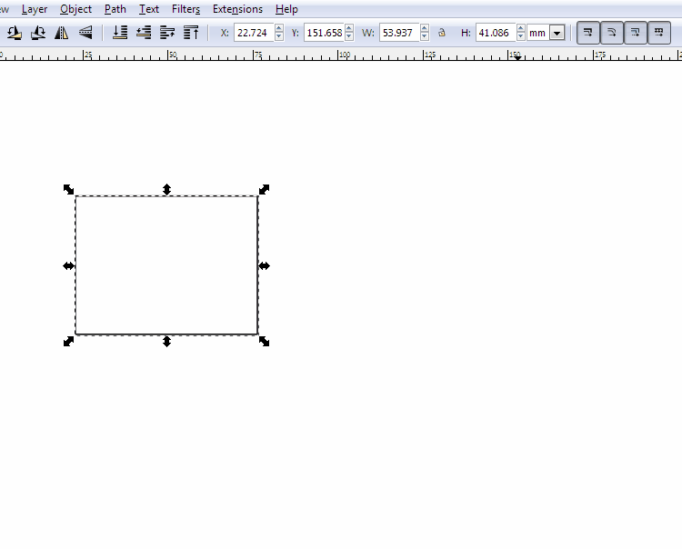
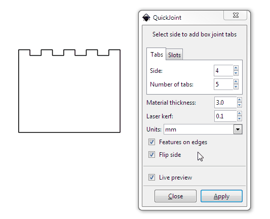
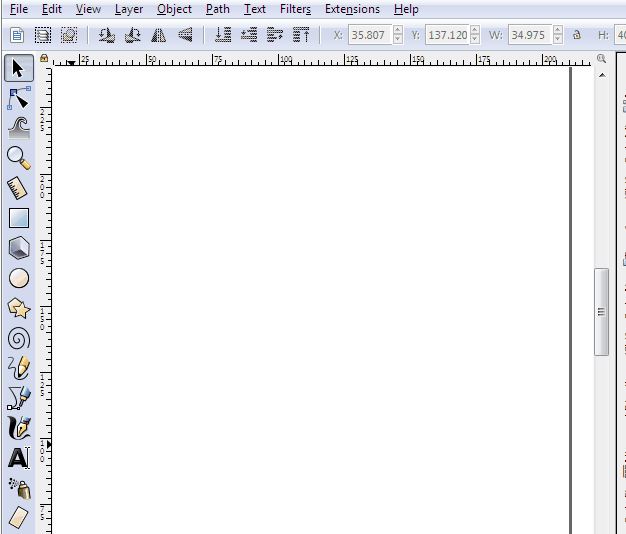

Assemblage Rapide
================

## Qu'est-ce que c'est ?

Ce projet est un fork du travail disponible sur https://jrainimo.com/build/.

C'est une extension Inkscape pour aider à prototyper rapidement des assemblages 3D à l'aide d'une découpe laser, d'une fraiseuse CNC, d'une découpe jet d'eau ou d'un procédé 2D similaire.

Elle permet d'ajouter rapidement des languettes de boîte aux objets.

La taille du matériau cible et d'autres propriétés mécaniques sont configurables.

Des fentes d'assemblage peuvent être générées en utilisant un chemin comme guide.

## Installation

Copiez le dossier **Jointure_rapide** dans le répertoire des extensions d'Inkscape (sous Windows : **%appdata%\inkscape\extensions**).
Si différent, le répertoire peut être trouvé dans Préférences/Système.

Redémarrez Inkscape.

L'extension sera disponible dans le menu « Extensions > Découpe laser > Assemblage rapide... ».

Elle peut être installée et mise à jour avec l'extension Màj : **extensions > Mise à jour des extensions de Frank SAURET...**.

Màj est téléchargeable  ici : https://github.com/FrankSAURET/Maj

## Contribuer

Les rapports de bugs et les pull requests sont les bienvenus. Il s'agit d'un petit projet secondaire, donc je ne m'attends pas à beaucoup de changements, mais les améliorations progressives sont appréciées.

## Pour aller plus loin

Jarret a écrit plus d'info sur ce projet, ainsi qu'un bref guide sur l'écriture d'extensions Inkscape sur son site web, [ici](https://jrainimo.com/build/?p=1380).